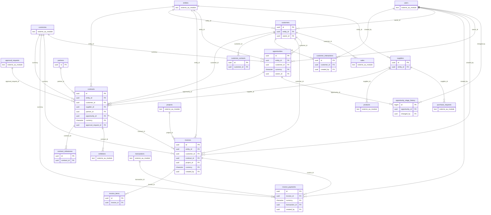
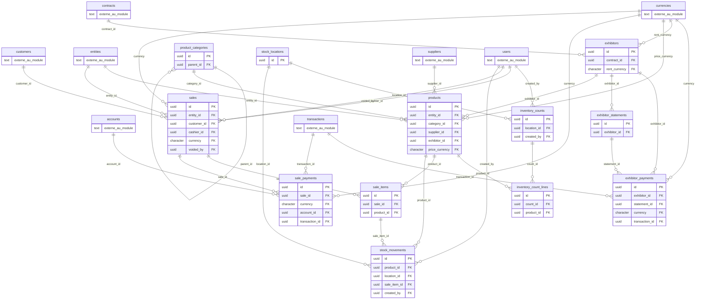

# Livrable 2 — Diagramme ERD

Un diagramme par module (lisible). Les clés étrangères vers un autre module sont signalées par la table cible en pointillé. Rendu: GitHub, VS Code (extension Mermaid) ou https://mermaid.live.

## Noyau

```mermaid
erDiagram
  accounts {
    text externe_au_module
  }
  activities {
    text externe_au_module
  }
  app_settings {
    text key PK
    uuid updated_by FK
  }
  approval_actions {
    text externe_au_module
  }
  approval_requests {
    text externe_au_module
  }
  approval_workflow_steps {
    text externe_au_module
  }
  approval_workflows {
    text externe_au_module
  }
  audit_logs {
    bigint id PK
  }
  budgets {
    text externe_au_module
  }
  campaign_results {
    text externe_au_module
  }
  content_items {
    text externe_au_module
  }
  contracts {
    text externe_au_module
  }
  currencies {
    character code PK
  }
  customer_interactions {
    text externe_au_module
  }
  customers {
    text externe_au_module
  }
  debts {
    text externe_au_module
  }
  departments {
    uuid id PK
    uuid head_user_id FK
  }
  documents {
    uuid id PK
    uuid uploaded_by FK
  }
  emergency_fund_rates {
    text externe_au_module
  }
  emergency_funds {
    text externe_au_module
  }
  employee_salaries {
    text externe_au_module
  }
  employees {
    text externe_au_module
  }
  entities {
    uuid id PK
    uuid parent_id FK
  }
  evaluations {
    text externe_au_module
  }
  exchange_rates {
    uuid id PK
    character from_currency FK
    character to_currency FK
    uuid entered_by FK
  }
  exhibitor_payments {
    text externe_au_module
  }
  exhibitors {
    text externe_au_module
  }
  fund_contributions {
    text externe_au_module
  }
  fund_withdrawals {
    text externe_au_module
  }
  inter_entity_transfers {
    text externe_au_module
  }
  inventory_counts {
    text externe_au_module
  }
  invoice_payments {
    text externe_au_module
  }
  invoices {
    text externe_au_module
  }
  job_openings {
    text externe_au_module
  }
  marketing_campaigns {
    text externe_au_module
  }
  notifications {
    text externe_au_module
  }
  opportunities {
    text externe_au_module
  }
  opportunity_stage_history {
    text externe_au_module
  }
  password_reset_tokens {
    uuid id PK
    uuid user_id FK
  }
  payments {
    text externe_au_module
  }
  payroll_entries {
    text externe_au_module
  }
  payroll_runs {
    text externe_au_module
  }
  permissions {
    uuid id PK
  }
  products {
    text externe_au_module
  }
  project_members {
    text externe_au_module
  }
  projects {
    text externe_au_module
  }
  purchase_requests {
    text externe_au_module
  }
  push_subscriptions {
    text externe_au_module
  }
  role_permissions {
    uuid role_id PK
    uuid permission_id PK
  }
  roles {
    uuid id PK
  }
  salary_adjustments {
    text externe_au_module
  }
  sale_payments {
    text externe_au_module
  }
  sales {
    text externe_au_module
  }
  stock_movements {
    text externe_au_module
  }
  suppliers {
    text externe_au_module
  }
  tasks {
    text externe_au_module
  }
  trainings {
    text externe_au_module
  }
  transaction_categories {
    text externe_au_module
  }
  transactions {
    text externe_au_module
  }
  user_roles {
    uuid user_id PK
    uuid role_id PK
    uuid entity_id FK
    uuid granted_by FK
  }
  user_sessions {
    uuid id PK
    uuid user_id FK
  }
  users {
    uuid id PK
    uuid department_id FK
    character display_currency FK
  }
  currencies ||--o{ accounts : "currency"
  entities ||--o{ accounts : "entity_id"
  departments ||--o{ activities : "department_id"
  users ||--o{ activities : "responsible_id"
  users ||--o{ app_settings : "updated_by"
  users ||--o{ approval_actions : "actor_id"
  currencies ||--o{ approval_requests : "currency"
  users ||--o{ approval_requests : "requester_id"
  roles ||--o{ approval_workflow_steps : "approver_role_id"
  users ||--o{ approval_workflow_steps : "approver_user_id"
  entities ||--o{ approval_workflows : "entity_id"
  users ||--o{ budgets : "created_by"
  currencies ||--o{ budgets : "currency"
  departments ||--o{ budgets : "department_id"
  entities ||--o{ budgets : "entity_id"
  currencies ||--o{ campaign_results : "currency"
  users ||--o{ content_items : "owner_id"
  currencies ||--o{ contracts : "currency"
  entities ||--o{ contracts : "entity_id"
  users ||--o{ customer_interactions : "created_by"
  entities ||--o{ customers : "entity_id"
  users ||--o{ customers : "owner_id"
  currencies ||--o{ debts : "currency"
  entities ||--o{ debts : "entity_id"
  users ||--o{ departments : "head_user_id"
  users ||--o{ documents : "uploaded_by"
  users ||--o{ emergency_fund_rates : "set_by"
  currencies ||--o{ emergency_funds : "currency"
  entities ||--o{ emergency_funds : "entity_id"
  currencies ||--o{ employee_salaries : "currency"
  departments ||--o{ employees : "department_id"
  entities ||--o{ employees : "entity_id"
  users ||--o{ employees : "user_id"
  entities ||--o{ entities : "parent_id"
  users ||--o{ evaluations : "evaluator_id"
  users ||--o{ exchange_rates : "entered_by"
  currencies ||--o{ exchange_rates : "from_currency"
  currencies ||--o{ exchange_rates : "to_currency"
  currencies ||--o{ exhibitor_payments : "currency"
  currencies ||--o{ exhibitors : "rent_currency"
  users ||--o{ fund_contributions : "created_by"
  currencies ||--o{ fund_contributions : "currency"
  currencies ||--o{ fund_withdrawals : "currency"
  users ||--o{ fund_withdrawals : "requested_by"
  users ||--o{ inter_entity_transfers : "created_by"
  currencies ||--o{ inter_entity_transfers : "currency"
  entities ||--o{ inter_entity_transfers : "from_entity_id"
  entities ||--o{ inter_entity_transfers : "to_entity_id"
  users ||--o{ inventory_counts : "created_by"
  users ||--o{ invoice_payments : "created_by"
  currencies ||--o{ invoice_payments : "currency"
  users ||--o{ invoices : "created_by"
  currencies ||--o{ invoices : "currency"
  entities ||--o{ invoices : "entity_id"
  departments ||--o{ job_openings : "department_id"
  currencies ||--o{ marketing_campaigns : "currency"
  departments ||--o{ marketing_campaigns : "department_id"
  entities ||--o{ marketing_campaigns : "entity_id"
  users ||--o{ marketing_campaigns : "owner_id"
  users ||--o{ notifications : "user_id"
  currencies ||--o{ opportunities : "currency"
  entities ||--o{ opportunities : "entity_id"
  users ||--o{ opportunities : "owner_id"
  users ||--o{ opportunity_stage_history : "changed_by"
  users ||--o{ password_reset_tokens : "user_id"
  users ||--o{ payments : "created_by"
  currencies ||--o{ payments : "currency"
  entities ||--o{ payments : "entity_id"
  currencies ||--o{ payroll_entries : "currency"
  users ||--o{ payroll_runs : "created_by"
  entities ||--o{ payroll_runs : "entity_id"
  entities ||--o{ products : "entity_id"
  currencies ||--o{ products : "price_currency"
  users ||--o{ project_members : "user_id"
  currencies ||--o{ projects : "currency"
  departments ||--o{ projects : "department_id"
  entities ||--o{ projects : "entity_id"
  users ||--o{ projects : "manager_id"
  currencies ||--o{ purchase_requests : "currency"
  departments ||--o{ purchase_requests : "department_id"
  entities ||--o{ purchase_requests : "entity_id"
  users ||--o{ purchase_requests : "requester_id"
  users ||--o{ push_subscriptions : "user_id"
  permissions ||--o{ role_permissions : "permission_id"
  roles ||--o{ role_permissions : "role_id"
  users ||--o{ salary_adjustments : "created_by"
  currencies ||--o{ salary_adjustments : "currency"
  currencies ||--o{ sale_payments : "currency"
  users ||--o{ sales : "cashier_id"
  currencies ||--o{ sales : "currency"
  entities ||--o{ sales : "entity_id"
  users ||--o{ sales : "voided_by"
  users ||--o{ stock_movements : "created_by"
  entities ||--o{ suppliers : "entity_id"
  users ||--o{ tasks : "assignee_id"
  users ||--o{ tasks : "created_by"
  departments ||--o{ tasks : "department_id"
  currencies ||--o{ trainings : "currency"
  entities ||--o{ transaction_categories : "entity_id"
  users ||--o{ transactions : "created_by"
  currencies ||--o{ transactions : "currency"
  departments ||--o{ transactions : "department_id"
  entities ||--o{ transactions : "entity_id"
  users ||--o{ transactions : "validated_by"
  entities ||--o{ user_roles : "entity_id"
  users ||--o{ user_roles : "granted_by"
  roles ||--o{ user_roles : "role_id"
  users ||--o{ user_roles : "user_id"
  users ||--o{ user_sessions : "user_id"
  departments ||--o{ users : "department_id"
  currencies ||--o{ users : "display_currency"
```

## Finance

```mermaid
erDiagram
  accounts {
    uuid id PK
    uuid entity_id FK
    character currency FK
  }
  approval_requests {
    text externe_au_module
  }
  budget_lines {
    uuid id PK
    uuid budget_id FK
    uuid category_id FK
  }
  budgets {
    uuid id PK
    uuid entity_id FK
    uuid department_id FK
    uuid project_id FK
    character currency FK
    uuid created_by FK
  }
  campaign_expenses {
    text externe_au_module
  }
  currencies {
    text externe_au_module
  }
  debt_payments {
    uuid id PK
    uuid debt_id FK
    uuid transaction_id FK
  }
  debts {
    uuid id PK
    uuid entity_id FK
    character currency FK
  }
  departments {
    text externe_au_module
  }
  emergency_fund_rates {
    uuid id PK
    uuid fund_id FK
    uuid approval_request_id FK
    uuid set_by FK
  }
  emergency_funds {
    uuid id PK
    uuid entity_id FK
    character currency FK
    uuid account_id FK
  }
  entities {
    text externe_au_module
  }
  exhibitor_payments {
    text externe_au_module
  }
  fund_contributions {
    uuid id PK
    uuid fund_id FK
    uuid source_tx_id FK
    uuid rate_id FK
    character currency FK
    uuid transaction_id FK
    uuid created_by FK
  }
  fund_withdrawals {
    uuid id PK
    uuid fund_id FK
    uuid requested_by FK
    character currency FK
    uuid approval_request_id FK
    uuid transaction_id FK
  }
  inter_entity_transfers {
    uuid id PK
    uuid from_entity_id FK
    uuid to_entity_id FK
    uuid out_tx_id FK
    uuid in_tx_id FK
    character currency FK
    uuid created_by FK
  }
  invoice_payments {
    text externe_au_module
  }
  invoices {
    text externe_au_module
  }
  marketing_campaigns {
    text externe_au_module
  }
  payments {
    uuid id PK
    uuid entity_id FK
    character currency FK
    uuid transaction_id FK
    uuid created_by FK
  }
  payroll_entries {
    text externe_au_module
  }
  project_expenses {
    text externe_au_module
  }
  project_members {
    text externe_au_module
  }
  projects {
    uuid id PK
    uuid entity_id FK
    uuid department_id FK
    uuid manager_id FK
    character currency FK
  }
  purchase_requests {
    text externe_au_module
  }
  resource_allocations {
    text externe_au_module
  }
  sale_payments {
    text externe_au_module
  }
  tasks {
    text externe_au_module
  }
  transaction_categories {
    uuid id PK
    uuid entity_id FK
    uuid parent_id FK
  }
  transactions {
    uuid id PK
    uuid entity_id FK
    uuid account_id FK
    uuid category_id FK
    uuid department_id FK
    uuid project_id FK
    character currency FK
    uuid reversal_of_id FK
    uuid created_by FK
    uuid validated_by FK
  }
  users {
    text externe_au_module
  }
  currencies ||--o{ accounts : "currency"
  entities ||--o{ accounts : "entity_id"
  budgets ||--o{ budget_lines : "budget_id"
  transaction_categories ||--o{ budget_lines : "category_id"
  users ||--o{ budgets : "created_by"
  currencies ||--o{ budgets : "currency"
  departments ||--o{ budgets : "department_id"
  entities ||--o{ budgets : "entity_id"
  projects ||--o{ budgets : "project_id"
  transactions ||--o{ campaign_expenses : "transaction_id"
  debts ||--o{ debt_payments : "debt_id"
  transactions ||--o{ debt_payments : "transaction_id"
  currencies ||--o{ debts : "currency"
  entities ||--o{ debts : "entity_id"
  approval_requests ||--o{ emergency_fund_rates : "approval_request_id"
  emergency_funds ||--o{ emergency_fund_rates : "fund_id"
  users ||--o{ emergency_fund_rates : "set_by"
  accounts ||--o{ emergency_funds : "account_id"
  currencies ||--o{ emergency_funds : "currency"
  entities ||--o{ emergency_funds : "entity_id"
  transactions ||--o{ exhibitor_payments : "transaction_id"
  users ||--o{ fund_contributions : "created_by"
  currencies ||--o{ fund_contributions : "currency"
  emergency_funds ||--o{ fund_contributions : "fund_id"
  emergency_fund_rates ||--o{ fund_contributions : "rate_id"
  transactions ||--o{ fund_contributions : "source_tx_id"
  transactions ||--o{ fund_contributions : "transaction_id"
  approval_requests ||--o{ fund_withdrawals : "approval_request_id"
  currencies ||--o{ fund_withdrawals : "currency"
  emergency_funds ||--o{ fund_withdrawals : "fund_id"
  users ||--o{ fund_withdrawals : "requested_by"
  transactions ||--o{ fund_withdrawals : "transaction_id"
  users ||--o{ inter_entity_transfers : "created_by"
  currencies ||--o{ inter_entity_transfers : "currency"
  entities ||--o{ inter_entity_transfers : "from_entity_id"
  transactions ||--o{ inter_entity_transfers : "in_tx_id"
  transactions ||--o{ inter_entity_transfers : "out_tx_id"
  entities ||--o{ inter_entity_transfers : "to_entity_id"
  transactions ||--o{ invoice_payments : "transaction_id"
  projects ||--o{ invoices : "project_id"
  budgets ||--o{ marketing_campaigns : "budget_id"
  projects ||--o{ marketing_campaigns : "project_id"
  users ||--o{ payments : "created_by"
  currencies ||--o{ payments : "currency"
  entities ||--o{ payments : "entity_id"
  transactions ||--o{ payments : "transaction_id"
  transactions ||--o{ payroll_entries : "transaction_id"
  projects ||--o{ project_expenses : "project_id"
  transactions ||--o{ project_expenses : "transaction_id"
  projects ||--o{ project_members : "project_id"
  currencies ||--o{ projects : "currency"
  departments ||--o{ projects : "department_id"
  entities ||--o{ projects : "entity_id"
  users ||--o{ projects : "manager_id"
  projects ||--o{ purchase_requests : "project_id"
  projects ||--o{ resource_allocations : "project_id"
  accounts ||--o{ sale_payments : "account_id"
  transactions ||--o{ sale_payments : "transaction_id"
  projects ||--o{ tasks : "project_id"
  entities ||--o{ transaction_categories : "entity_id"
  transaction_categories ||--o{ transaction_categories : "parent_id"
  accounts ||--o{ transactions : "account_id"
  transaction_categories ||--o{ transactions : "category_id"
  users ||--o{ transactions : "created_by"
  currencies ||--o{ transactions : "currency"
  departments ||--o{ transactions : "department_id"
  entities ||--o{ transactions : "entity_id"
  projects ||--o{ transactions : "project_id"
  transactions ||--o{ transactions : "reversal_of_id"
  users ||--o{ transactions : "validated_by"
```

## Ressources humaines

```mermaid
erDiagram
  approval_requests {
    text externe_au_module
  }
  attendance_records {
    uuid id PK
    uuid employee_id FK
  }
  candidates {
    uuid id PK
    uuid job_opening_id FK
  }
  currencies {
    text externe_au_module
  }
  departments {
    text externe_au_module
  }
  departures {
    uuid id PK
    uuid employee_id FK
  }
  employee_salaries {
    uuid id PK
    uuid employee_id FK
    character currency FK
  }
  employees {
    uuid id PK
    uuid user_id FK
    uuid department_id FK
    uuid entity_id FK
    uuid manager_id FK
  }
  employment_history {
    uuid id PK
    uuid employee_id FK
  }
  entities {
    text externe_au_module
  }
  evaluations {
    uuid id PK
    uuid employee_id FK
    uuid evaluator_id FK
  }
  job_openings {
    uuid id PK
    uuid department_id FK
  }
  leave_requests {
    uuid id PK
    uuid employee_id FK
    uuid leave_type_id FK
    uuid approval_request_id FK
  }
  leave_types {
    uuid id PK
  }
  payroll_entries {
    uuid id PK
    uuid payroll_run_id FK
    uuid employee_id FK
    character currency FK
    uuid transaction_id FK
  }
  payroll_runs {
    uuid id PK
    uuid entity_id FK
    uuid approval_request_id FK
    uuid created_by FK
  }
  salary_adjustments {
    uuid id PK
    uuid employee_id FK
    character currency FK
    uuid approval_request_id FK
    uuid created_by FK
  }
  training_participants {
    uuid training_id PK
    uuid employee_id PK
  }
  trainings {
    uuid id PK
    character currency FK
  }
  transactions {
    text externe_au_module
  }
  users {
    text externe_au_module
  }
  employees ||--o{ attendance_records : "employee_id"
  job_openings ||--o{ candidates : "job_opening_id"
  employees ||--o{ departures : "employee_id"
  currencies ||--o{ employee_salaries : "currency"
  employees ||--o{ employee_salaries : "employee_id"
  departments ||--o{ employees : "department_id"
  entities ||--o{ employees : "entity_id"
  employees ||--o{ employees : "manager_id"
  users ||--o{ employees : "user_id"
  employees ||--o{ employment_history : "employee_id"
  employees ||--o{ evaluations : "employee_id"
  users ||--o{ evaluations : "evaluator_id"
  departments ||--o{ job_openings : "department_id"
  approval_requests ||--o{ leave_requests : "approval_request_id"
  employees ||--o{ leave_requests : "employee_id"
  leave_types ||--o{ leave_requests : "leave_type_id"
  currencies ||--o{ payroll_entries : "currency"
  employees ||--o{ payroll_entries : "employee_id"
  payroll_runs ||--o{ payroll_entries : "payroll_run_id"
  transactions ||--o{ payroll_entries : "transaction_id"
  approval_requests ||--o{ payroll_runs : "approval_request_id"
  users ||--o{ payroll_runs : "created_by"
  entities ||--o{ payroll_runs : "entity_id"
  approval_requests ||--o{ salary_adjustments : "approval_request_id"
  users ||--o{ salary_adjustments : "created_by"
  currencies ||--o{ salary_adjustments : "currency"
  employees ||--o{ salary_adjustments : "employee_id"
  employees ||--o{ training_participants : "employee_id"
  trainings ||--o{ training_participants : "training_id"
  currencies ||--o{ trainings : "currency"
```

## Affaires

## Marketing et opérations

```mermaid
erDiagram
  activities {
    uuid id PK
    uuid department_id FK
    uuid responsible_id FK
  }
  budgets {
    text externe_au_module
  }
  campaign_expenses {
    uuid id PK
    uuid campaign_id FK
    uuid transaction_id FK
  }
  campaign_results {
    uuid id PK
    uuid campaign_id FK
    character currency FK
  }
  content_items {
    uuid id PK
    uuid campaign_id FK
    uuid owner_id FK
  }
  currencies {
    text externe_au_module
  }
  departments {
    text externe_au_module
  }
  entities {
    text externe_au_module
  }
  marketing_campaigns {
    uuid id PK
    uuid entity_id FK
    uuid department_id FK
    uuid project_id FK
    uuid budget_id FK
    character currency FK
    uuid owner_id FK
  }
  project_expenses {
    uuid id PK
    uuid project_id FK
    uuid transaction_id FK
  }
  project_members {
    uuid project_id PK
    uuid user_id PK
  }
  projects {
    text externe_au_module
  }
  resource_allocations {
    uuid id PK
    uuid resource_id FK
    uuid project_id FK
    uuid task_id FK
  }
  resources {
    uuid id PK
  }
  tasks {
    uuid id PK
    uuid project_id FK
    uuid department_id FK
    uuid parent_task_id FK
    uuid assignee_id FK
    uuid created_by FK
  }
  transactions {
    text externe_au_module
  }
  users {
    text externe_au_module
  }
  departments ||--o{ activities : "department_id"
  users ||--o{ activities : "responsible_id"
  marketing_campaigns ||--o{ campaign_expenses : "campaign_id"
  transactions ||--o{ campaign_expenses : "transaction_id"
  marketing_campaigns ||--o{ campaign_results : "campaign_id"
  currencies ||--o{ campaign_results : "currency"
  marketing_campaigns ||--o{ content_items : "campaign_id"
  users ||--o{ content_items : "owner_id"
  budgets ||--o{ marketing_campaigns : "budget_id"
  currencies ||--o{ marketing_campaigns : "currency"
  departments ||--o{ marketing_campaigns : "department_id"
  entities ||--o{ marketing_campaigns : "entity_id"
  users ||--o{ marketing_campaigns : "owner_id"
  projects ||--o{ marketing_campaigns : "project_id"
  projects ||--o{ project_expenses : "project_id"
  transactions ||--o{ project_expenses : "transaction_id"
  projects ||--o{ project_members : "project_id"
  users ||--o{ project_members : "user_id"
  projects ||--o{ resource_allocations : "project_id"
  resources ||--o{ resource_allocations : "resource_id"
  tasks ||--o{ resource_allocations : "task_id"
  users ||--o{ tasks : "assignee_id"
  users ||--o{ tasks : "created_by"
  departments ||--o{ tasks : "department_id"
  tasks ||--o{ tasks : "parent_task_id"
  projects ||--o{ tasks : "project_id"
```

## MOJO Store

## Approbations et notifications

```mermaid
erDiagram
  approval_actions {
    uuid id PK
    uuid request_id FK
    uuid actor_id FK
  }
  approval_requests {
    uuid id PK
    uuid workflow_id FK
    uuid requester_id FK
    character currency FK
  }
  approval_workflow_steps {
    uuid id PK
    uuid workflow_id FK
    uuid approver_role_id FK
    uuid approver_user_id FK
  }
  approval_workflows {
    uuid id PK
    uuid entity_id FK
  }
  contracts {
    text externe_au_module
  }
  currencies {
    text externe_au_module
  }
  departments {
    text externe_au_module
  }
  emergency_fund_rates {
    text externe_au_module
  }
  entities {
    text externe_au_module
  }
  fund_withdrawals {
    text externe_au_module
  }
  leave_requests {
    text externe_au_module
  }
  notifications {
    uuid id PK
    uuid user_id FK
  }
  payroll_runs {
    text externe_au_module
  }
  projects {
    text externe_au_module
  }
  purchase_requests {
    uuid id PK
    uuid entity_id FK
    uuid department_id FK
    uuid project_id FK
    uuid supplier_id FK
    uuid requester_id FK
    character currency FK
    uuid approval_request_id FK
  }
  push_subscriptions {
    uuid id PK
    uuid user_id FK
  }
  roles {
    text externe_au_module
  }
  salary_adjustments {
    text externe_au_module
  }
  suppliers {
    text externe_au_module
  }
  users {
    text externe_au_module
  }
  users ||--o{ approval_actions : "actor_id"
  approval_requests ||--o{ approval_actions : "request_id"
  currencies ||--o{ approval_requests : "currency"
  users ||--o{ approval_requests : "requester_id"
  approval_workflows ||--o{ approval_requests : "workflow_id"
  roles ||--o{ approval_workflow_steps : "approver_role_id"
  users ||--o{ approval_workflow_steps : "approver_user_id"
  approval_workflows ||--o{ approval_workflow_steps : "workflow_id"
  entities ||--o{ approval_workflows : "entity_id"
  approval_requests ||--o{ contracts : "approval_request_id"
  approval_requests ||--o{ emergency_fund_rates : "approval_request_id"
  approval_requests ||--o{ fund_withdrawals : "approval_request_id"
  approval_requests ||--o{ leave_requests : "approval_request_id"
  users ||--o{ notifications : "user_id"
  approval_requests ||--o{ payroll_runs : "approval_request_id"
  approval_requests ||--o{ purchase_requests : "approval_request_id"
  currencies ||--o{ purchase_requests : "currency"
  departments ||--o{ purchase_requests : "department_id"
  entities ||--o{ purchase_requests : "entity_id"
  projects ||--o{ purchase_requests : "project_id"
  users ||--o{ purchase_requests : "requester_id"
  suppliers ||--o{ purchase_requests : "supplier_id"
  users ||--o{ push_subscriptions : "user_id"
  approval_requests ||--o{ salary_adjustments : "approval_request_id"
```

