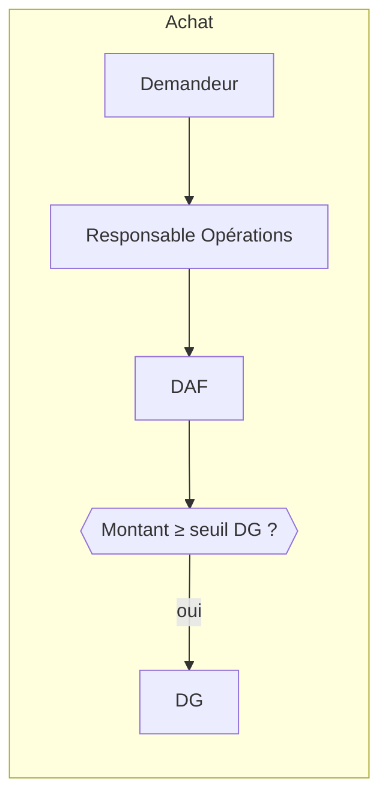
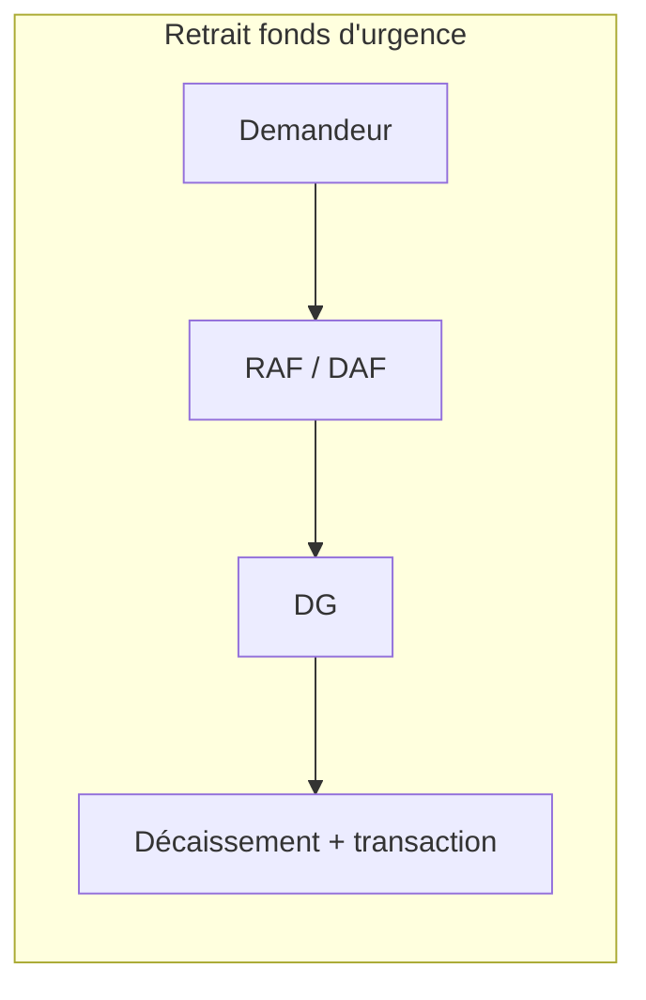

# Livrable 5 — Workflows d'approbation

## Fonctionnement du moteur
- Un **workflow** par type de demande (`approval_workflows`), composé d'**étapes ordonnées** (`approval_workflow_steps`).
- Chaque étape désigne un rôle (ou un utilisateur) approbateur et un **seuil optionnel** `min_amount_usd` : étape ignorée si le montant (converti en USD au taux du jour) est inférieur ; seuil vide = étape toujours requise.
- Une demande (`approval_requests`) avance étape par étape ; chaque décision est tracée (`approval_actions`) et auditée. Un refus clôt la demande ; « renvoyer » la retourne au demandeur.
- Règles : le demandeur ne peut pas approuver sa propre demande ; un approbateur doit avoir `approvals.approve` ; toutes les étapes/seuils sont modifiables depuis l'administration (`approvals.configure`).

## Workflows initiaux

| Type | Étapes initiales | Seuil |
|---|---|---|
| purchase | Resp. Opérations → DAF → DG | DG si montant ≥ seuil |
| expense | DAF → DG | DG si montant ≥ seuil |
| fund_withdrawal | DAF → DG | toujours |
| fund_rate (modifier le %) | DG | toujours |
| leave | Responsable RH | — |
| payroll | DAF → DG | toujours |
| contract | Resp. Affaires → DG | toujours |
| project | DG | toujours |

### Décision provisoire du propriétaire

Pour `purchase` et `expense`, l’approbation DG est requise pour tout montant positif.
Le seuil technique initial de 0,01 USD représente cette règle temporaire; il ne fixe
pas le seuil monétaire définitif, qui pourra être révisé. Aucun délai d’escalade ni
canal de notification externe n’est décidé à ce stade.

## États d'une demande
`pending → approved | rejected | cancelled`. À l'approbation finale, le service métier concerné déclenche l'action (ex. création de la transaction de décaissement).

## État d'implémentation

- Le premier parcours applicatif couvre la soumission d'une dépense Finance en brouillon au workflow actif `expense`, puis les décisions d'approbation/refus par l'approbateur désigné à l'étape courante. Une demande avance dans l'ordre configuré; le demandeur ne peut pas décider sur sa propre demande.
- La décision DG temporaire du propriétaire est appliquée : la valeur USD utilisée par le workflow est au minimum 0,01 pour une dépense positive, afin que le seuil DG initial de 0,01 ne soit pas contourné par les arrondis de conversion.
- Après l'approbation finale, la dépense reste en attente de validation comptable indépendante. Le refus clôt la demande et rejette le brouillon.
- Les notifications sont uniquement dans l'application : nouvel avis au prochain approbateur et résultat final au demandeur. Aucun e-mail, push ni délai d'escalade n'est activé.
- À ce stade, les parcours achat, retour au demandeur, gestion visuelle des workflows et soumission des budgets ne sont pas encore disponibles. Les règles de seuil, étapes et rôles restent issues des workflows déjà configurés en base.
- Les tests automatisés du projet, le typecheck, lint et build couvrent la compilation et les régressions générales; une recette avec comptes/entité dédiés reste nécessaire avant de déclarer le parcours validé.
