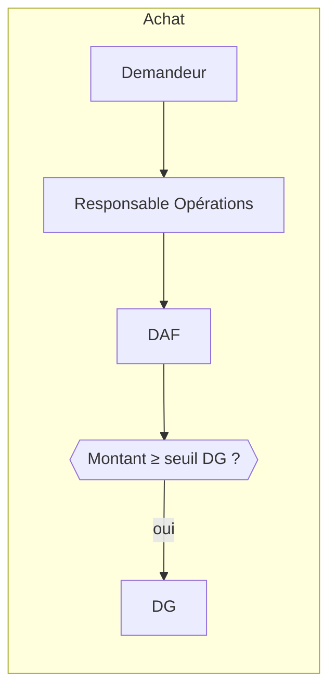
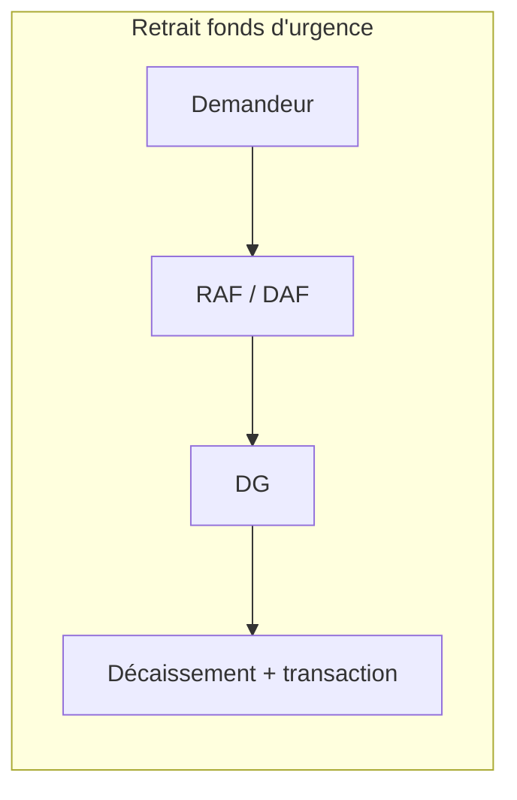

# Livrable 5 — Workflows d'approbation

## Fonctionnement du moteur
- Un **workflow** par type de demande (`approval_workflows`), composé d'**étapes ordonnées** (`approval_workflow_steps`).
- Chaque étape désigne un rôle (ou un utilisateur) approbateur et un **seuil optionnel** `min_amount_usd` : étape ignorée si le montant (converti en USD au taux du jour) est inférieur ; seuil vide = étape toujours requise.
- Une demande (`approval_requests`) avance étape par étape ; chaque décision est tracée (`approval_actions`) et auditée. Un refus clôt la demande. « Renvoyer » clôt le cycle courant en état `returned`, remet la ressource (dépense, achat ou budget) en brouillon et notifie le demandeur; une resoumission démarre un nouveau cycle au premier approbateur et conserve l’historique précédent.
- Règles : le demandeur ne peut pas approuver sa propre demande ; un approbateur doit avoir `approvals.approve` ; toutes les étapes/seuils sont modifiables depuis l'administration (`approvals.configure`).

## Workflows initiaux

| Type | Étapes initiales | Seuil |
|---|---|---|
| purchase | Resp. Opérations → DAF → DG | DG si montant ≥ seuil |
| expense | DAF → DG | DG si montant ≥ seuil |
| fund_withdrawal | DAF → DG | toujours |
| fund_rate (modifier le %) | DG | toujours |
| leave | Responsable RH | — |
| payroll | DAF → DG | toujours |
| contract | Resp. Affaires → DG | toujours |
| project | DG | toujours |

### Décision provisoire du propriétaire

Pour `purchase` et `expense`, l’approbation DG est requise pour tout montant positif.
Le seuil technique initial de 0,01 USD représente cette règle temporaire; il ne fixe
pas le seuil monétaire définitif, qui pourra être révisé. Aucun délai d’escalade ni
canal de notification externe n’est décidé à ce stade.

## États d'une demande
`pending → approved | rejected | cancelled | returned`. Un cycle `returned` est terminé; la dépense, l’achat ou le budget redevient modifiable en brouillon. Une resoumission crée un nouveau cycle `pending` et recommence à la première étape. À l'approbation finale, le service métier concerné déclenche l'action (ex. création de la transaction de décaissement).

## État d'implémentation

- Le premier parcours applicatif couvre la soumission d'une dépense Finance en brouillon au workflow actif `expense`, puis les décisions d'approbation/refus par l'approbateur désigné à l'étape courante. Une demande avance dans l'ordre configuré; le demandeur ne peut pas décider sur sa propre demande.
- Un approbateur peut renvoyer une dépense, un achat ou un budget à son demandeur pour modification avec un commentaire facultatif. La décision et le commentaire restent dans `approval_actions`; le cycle passe à `returned`, la ressource redevient `draft` et une notification in-app est envoyée au demandeur. Après modification, la resoumission ouvre un nouveau cycle qui repart de la première étape.
- L’écran d’administration `/settings/approval-workflows` permet aux utilisateurs autorisés de modifier le nom, l’activation, l’ordre des étapes, les rôles/utilisateurs approbateurs et les seuils en USD. Les contrôles sont journalisés; la sauvegarde est bloquée tant qu’une demande du workflow est en attente afin de ne pas changer les décisions d’un cycle en cours.
- Le module Approbations fournit les files « À traiter », « Mes demandes » et « Historique ». La file de traitement ne montre que les demandes affectées à l’étape de l’utilisateur avec la permission d’approbation sur l’entité. « Mes demandes » ne montre que ses propres cycles; l’historique présente les cycles clos du demandeur et ceux pour lesquels l’utilisateur a pris une décision, avec commentaires et horodatages. Les dépenses, achats et budgets sont raccordés. Dans la file, chaque type est identifié et les trois peuvent être renvoyés avec un commentaire facultatif.
- Les demandes de taux du fonds (`fund_rate`) et de retrait (`fund_withdrawal`) sont également visibles dans ces trois listes. Le taux passe par l’étape DG; un retrait suit DAF puis DG et n’est réservé/décaissé qu’après l’approbation finale et une vérification atomique du solde disponible. Ces deux demandes peuvent être approuvées ou refusées, jamais renvoyées à l’état brouillon.
- Le module Finance permet de soumettre une demande d’achat via l’entité, une description, un montant et une devise. La création est atomique avec le cycle d’approbation, applique le workflow `purchase` actif, convertit le montant au taux USD de la date et notifie le premier approbateur. Les décisions d’approbation/refus/renvoi mettent à jour le statut de la demande; le demandeur peut modifier un brouillon renvoyé et le resoumettre, avec un nouveau cycle qui conserve l’historique. Il peut ensuite marquer ses achats approuvés comme `ordered`, puis `received`; l’API limite ces transitions à cet ordre et contrôle les permissions de l’entité.
- Un budget brouillon peut être soumis par son créateur. La migration 021 initialise le workflow `budget` DAF puis DG, avec seuils `NULL`; les approbateurs et seuils restent administrables. Les budgets refusés sont conservés à l’état `rejected`. Un budget renvoyé redevient modifiable par son créateur; sa resoumission ouvre un nouveau cycle sans supprimer les décisions précédentes.
- Les champs facultatifs fournisseur, direction et projet du schéma ne sont pas encore exposés dans le formulaire d’achat.
- La décision DG temporaire du propriétaire est appliquée : la valeur USD utilisée par le workflow est au minimum 0,01 pour une dépense positive, afin que le seuil DG initial de 0,01 ne soit pas contourné par les arrondis de conversion.
- Après l'approbation finale, la dépense reste en attente de validation comptable indépendante. Le refus clôt la demande et rejette le brouillon.
- Le centre in-app gère le badge, la liste et le marquage comme lu. Les tâches planifiées sont déclenchées par `POST /api/internal/scheduled-notifications`, protégé par `MOJO_SCHEDULED_TASK_TOKEN`; elles dédupliquent les rappels par événement et destinataire. Le script Windows est `scripts/run_scheduled_notifications.ps1`.
- Le code des tâches planifiées contient des candidats pour factures, paiements attendus, contrats, budgets et projets. La validation de bout en bout des rappels de factures/paiements, contrats et projets reste ouverte jusqu’à ce que leurs modules et parcours utilisateurs soient opérationnels; ne pas inventer ni figer leurs règles métier en attendant ces dépendances.
- Le prérequis de la feuille de route (Lot 4 validé) reste à satisfaire. Le Lot 5 demeure non validé jusqu’à la validation explicite du Lot 4, la fermeture des dépendances convenues et l’acceptation d’Augustin.
- L’intégration du Lot 6 ajoute les deux types ci-dessus au moteur d’approbation; leur configuration initiale est créée par la migration 023. Cette migration et les parcours authentifiés restent à tester sur une base QA explicitement isolée avant mise en service.
- Le push web est optionnel et alimenté après la réponse depuis une file transactionnelle. Il exige les trois variables VAPID documentées dans `.env.example`, HTTPS/localhost et la migration 021. Les tentatives sont limitées et les abonnements expirés sont supprimés.
- Tests automatisés (14/14), typecheck, lint et build Webpack relancés avec succès après ces changements dans le runtime QA. Les parcours authentifiés retour/commentaire/édition/resoumission des achats et budgets, les nouveaux cycles DAF→DG, les transitions achat `approved` → `ordered` → `received` et les refus 403/409 ont réussi sur la base isolée. Les données métier et sessions créées pour cette recette ont été nettoyées. Aucun POST métier valide ni décision n’est autorisé sur la base principale; Lot 5 reste non validé.
